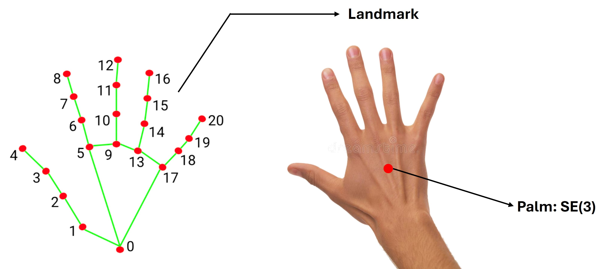

**한국어** | [English](README.md)

# Meta_for_teleoperation

**Meta Quest(Horizon OS)용 Unity 앱.** Passthrough 화면 위에 손(hand tracking)을
시각화하고, HMD·양손(21 landmark)·컨트롤러의 pose/입력 상태를 초당 60개의
UDP 패킷으로 PC에 실시간 전송한다. PC가 헤드셋에 등록하고 헤드셋이 응답 패킷을 보낸다.

```
Meta Quest (Unity APK)  ──UDP :5555 (60 Hz JSON)──▶  PC (subscriber / 로봇 제어 등)
                         ◀── UDP 등록 패킷 ──────────
```

## 전송 방식

| 항목 | 값 |
| --- | --- |
| 프로토콜 | **UDP** — PC가 `udp://<헤드셋IP>:5555`로 등록 패킷을 보내고, pose 패킷은 PC의 송신 endpoint로 돌아온다 |
| 포트 | `5555` (Inspector에서 변경 가능) |
| 포맷 | UTF-8 JSON 객체 하나를 UDP datagram 하나에 담는다 |
| 주기 | 기본 **초당 60 datagram** (`publishRateHz`). pose 샘플은 Unity 렌더 프레임마다 갱신되므로 렌더 주기가 60 Hz보다 낮으면 최신 샘플이 반복될 수 있다 |
| 시맨틱 | 최신 pose 스냅샷을 등록된 endpoint로 전송한다. 3초간 등록 heartbeat가 없으면 endpoint를 제거한다 |
| 발행 보장 | UDP는 best-effort 방식으로 패킷이 유실되거나 순서가 바뀔 수 있다. 추적되지 않은 소스도 `tracked: false`로 전송한다 |

퍼블리셔(`PoseFramePublisher`)는 `SampleScene`의 `PosePublisher` 오브젝트로 씬에
이미 배선돼 있어 수동 작업이 필요 없고, 갓 빌드한 APK가 바로 송신을 시작한다.
필요한 권한(`INTERNET`, `com.oculus.permission.HAND_TRACKING`)은 빌드 시
매니페스트에 자동 주입된다.

**수신 테스트** (PC, 표준 라이브러리만 사용):

```bash
python Tools/subscriber.py --host <헤드셋IP> --port 5555
```

헤드셋 IP는 기기의 Wi-Fi 설정에서 확인하고, PC와 같은 네트워크에 있어야 한다. 필요하면 PC 방화벽에서 UDP 5555를 허용한다.

## 데이터 스키마

한 datagram = 한 pose 스냅샷. `timestamp` / `frame` / `hmd` / `hands`(손, 21 landmark) /
`controllers`(컨트롤러)로 구성된다. 필드별 정의·좌표계·생략 규칙은:

**→ [SCHEMA_KOR.md](SCHEMA_KOR.md)**

(Galaxy_with_hands 저장소와 **동일한 스키마**를 쓴다 — 수신측 코드는 두 헤드셋을
구분 없이 그대로 재사용할 수 있다.)

## 기기 매핑

어떤 물리 입력이 어떤 JSON 필드로 나가는지, 손 랜드마크 21점의 번호는 어떻게
매겨지는지:




## APK 빌드

### 필수 설치 (머신에 직접)

| 필요한 것 | 비고 |
| --- | --- |
| **Unity Editor `6000.2.12f1`** | 이 프로젝트의 고정 버전 (Unity Hub로 설치) |
| **Android Build Support 모듈** | 위 에디터에 Hub로 추가. OpenJDK + Android SDK/NDK가 번들되므로 별도 설치 불필요 |
| **`adb`** (Android platform-tools) | APK를 기기에 설치하고 로그를 보는 데 필요 (빌드 자체에는 불필요). Ubuntu/Debian은 `sudo apt install adb`. Android Build Support에 번들된 `<Editor>/Data/PlaybackEngines/AndroidPlayer/SDK/platform-tools/adb`를 PATH에 추가해 써도 된다 |

그 외 프로젝트 설정(패키지, 씬, XR 설정, 권한)은 **전부 repo에 포함**돼 있어 클론 후
Unity로 열면 자동 복원된다. 첫 오픈 시 패키지 임포트가 끝나면 한 번만 확인:
**Project Settings ▸ XR Plug-in Management ▸ Android**에서 `OpenXR` 로더와
`Hand Tracking Subsystem` + `Meta Quest Support` + `AR Session`/`AR Camera`(Meta)
기능이 켜져 있는지.

### 빌드 방법

- **에디터 메뉴**: `Build ▸ Android APK` → `Build/<productName>.apk`
- **배치 모드** (에디터 UI 없이):
  ```bash
  Unity -quit -batchmode -nographics -projectPath . \
        -buildTarget Android -executeMethod BuildAndroid.Build \
        -output Build/Meta_with_hands.apk
  ```
- **두 APK 한 번에** (권장):
  ```bash
  UNITY=~/Unity/Hub/Editor/6000.2.12f1/Editor/Unity ./Tools/build_all.sh
  # → Build/Meta_with_hands.apk        (com.dongridong.metahand)
  # → Build/Meta_with_controllers.apk  (com.dongridong.metacontroller)
  ```
  두 APK는 패키지명이 달라 헤드셋에 **나란히 설치**된다. 제품 정체성은 빌드 인자
  (`-productName` / `-applicationIdentifier`)로 주입되고 빌드 후 원복되므로
  `ProjectSettings.asset`은 더러워지지 않는다.

### 기기에 설치

1. Quest **개발자 모드** 활성화(Meta Horizon 모바일 앱), PC에 `adb` 준비,
   USB(또는 무선 adb) 연결.
2. 서명은 키 미지정 시 **디버그 서명이 자동 적용** → sideload에 별도 키 불필요.
   ```bash
   adb install -r Build/Meta_with_hands.apk
   ```
3. 첫 실행 시 **손 추적 권한** 다이얼로그 허용.

## 자매 저장소

같은 스키마·구성의 **Samsung Galaxy XR(Android XR)판**: `Galaxy_with_hands`
(github.com/dongridong/Galaxy_with_hands). Unity XR 설정(플러그인·패키지)만 기기에
맞게 다르고, 전송 방식과 와이어 포맷은 동일하다.
