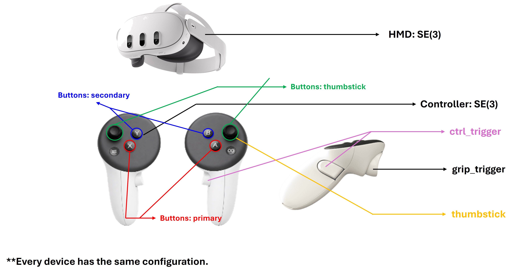

[한국어](SCHEMA_KOR.md) | **English**

# Data schema (TCP NDJSON)

Wire format of the stream the headset sends.
**One line = one UTF-8 JSON object = one frame** (`\n`-terminated, NDJSON).

## Common conventions

| Item | Value |
| --- | --- |
| Coordinate system | `robot_world` — **RIGHT-HANDED**, **+X forward / +Y left / +Z up (sky)**, unit **metres** (FLU: Forward-Left-Up, ROS REP-103 style) |
| Rotation | Quaternion, array order **`[x, y, z, w]`** (⚠ *not* `[w,x,y,z]`) |
| Position | `[x, y, z]` |
| Number format | At most 6 decimal places, decimal separator always `.` (InvariantCulture) |
| Array order | `hands` and `controllers` are both always **exactly 2 entries, in `[left, right]` order** |

> **The coordinate conversion is done on the sending side (the publisher).**
> Internally the headset (Unity) uses a left-handed, Y-up frame, but at
> serialization time it is converted to the right-handed FLU frame as follows:
>
> - Position: `(x, y, z)_unity → (z, −x, y)`
> - Quaternion: `(x, y, z, w)_unity → (−z, x, −y, w)`
>
> **+X forward** is the initial forward direction of the XR tracking space — the
> direction the user was facing when the app started (or was recentred). The
> receiver (robot, etc.) can use the values as-is, with no further conversion.

### Omission rules (your parser must handle these)

- An object with `"tracked": false` (hmd / hand / controller) **has none of its
  sub-keys at all** (e.g. an untracked hand ends at
  `{"side":"left","tracked":false}` — no `palm`/`landmarks`).
- A pose with `"valid": false` (palm / landmark / grip / aim) **omits**
  `position`/`rotation` (they are not zero-filled).

## Full example (actual serialization order)

```json
{
  "timestamp": 12.345,
  "frame": 1024,
  "coordinate_system": "robot_world",
  "hmd": { "tracked": true, "position": [0, 0, 1.6], "rotation": [0, 0, 0, 1] },
  "hands": [
    {
      "side": "left",
      "tracked": true,
      "palm": { "valid": true, "position": [0, 0, 0], "rotation": [0, 0, 0, 1] },
      "landmarks": [
        { "i": 0, "valid": true, "position": [0, 0, 0], "rotation": [0, 0, 0, 1] }
        /* … 21 entries, i = 0..20 … */
      ]
    },
    { "side": "right", "tracked": false }
  ],
  "controllers": [
    {
      "side": "left",
      "tracked": true,
      "controller": { "valid": true, "position": [0, 0, 0], "rotation": [0, 0, 0, 1] },
      "grip_trigger": 0.85,
      "ctrl_trigger": 0.12,
      "thumbstick": [0.0, -0.7],
      "buttons": { "primary": false, "secondary": false, "menu": false, "thumbstick": false }
    },
    { "side": "right", "tracked": false }
  ]
}
```

- `timestamp` — seconds elapsed since app start (double).
- `frame` — render frame number at capture time (int).

## `hmd`

| Field | Type | Description |
| --- | --- | --- |
| `tracked` | bool | If false, the two fields below are omitted |
| `position` | [x,y,z] | Headset position (m) |
| `rotation` | [x,y,z,w] | Headset rotation |

---

## `hands` — hand tracking

Always 2 entries, `[left, right]`. Each entry:

| Field | Type | Description |
| --- | --- | --- |
| `side` | `"left"` \| `"right"` | Which hand |
| `tracked` | bool | If false, everything below is omitted |
| `palm` | pose | Pose of the palm centre. `{valid, position, rotation}` |
| `landmarks` | array(21) | 21 landmarks, in the fixed order of the table below |

- **`palm` definition**: the OpenXR `Palm` joint is used when available. If the
  runtime does not provide it, position falls back to
  `midpoint(Wrist, MiddleProximal)` and rotation to the Wrist rotation.
- Each landmark entry is
  `{ "i": <0..20>, "valid": bool, "position": …, "rotation": … }`.
  If a single joint is missing in a given frame, only that entry becomes
  `{"i": n, "valid": false}`.

### Landmark order (MediaPipe 21-point standard)

| i | Name | ← OpenXR joint | i | Name | ← OpenXR joint |
|---|---|---|---|---|---|
| 0 | WRIST | Wrist | 11 | MIDDLE_DIP | MiddleDistal |
| 1 | THUMB_CMC | ThumbMetacarpal | 12 | MIDDLE_TIP | MiddleTip |
| 2 | THUMB_MCP | ThumbProximal | 13 | RING_MCP | RingProximal |
| 3 | THUMB_IP | ThumbDistal | 14 | RING_PIP | RingIntermediate |
| 4 | THUMB_TIP | ThumbTip | 15 | RING_DIP | RingDistal |
| 5 | INDEX_MCP | IndexProximal | 16 | RING_TIP | RingTip |
| 6 | INDEX_PIP | IndexIntermediate | 17 | PINKY_MCP | LittleProximal |
| 7 | INDEX_DIP | IndexDistal | 18 | PINKY_PIP | LittleIntermediate |
| 8 | INDEX_TIP | IndexTip | 19 | PINKY_DIP | LittleDistal |
| 9 | MIDDLE_MCP | MiddleProximal | 20 | PINKY_TIP | LittleTip |
| 10 | MIDDLE_PIP | MiddleIntermediate | | | |

(Of the 26 OpenXR joints, only the 21 that map to MediaPipe are used. The
metacarpal joints of the index through little fingers, and the Palm joint, are
excluded from the landmarks — the palm is provided as its own field.)

---

## `controllers`



*The figure labels each physical input with the JSON field it is published as.
Note `grip_trigger` = the index-finger (front) trigger and `ctrl_trigger` = the
grip (side) trigger — see the mapping table below. The same layout applies to
every supported device.*

Always 2 entries, `[left, right]`. This is a **completely independent source
from `hands`**, not a mode switch. Within a single frame hands and controllers
may **both** be present, **only one**, or **neither**; the receiver picks
whichever side reports `tracked`.

Each entry (when tracked=true, in serialization order):

| Field | Type | Description |
| --- | --- | --- |
| `side` | `"left"` \| `"right"` | Which hand's controller |
| `tracked` | bool | If false, everything below is omitted |
| `controller` | pose | **6DoF pose of the controller grip** (counterpart to `palm` in `hands`) |
| `grip_trigger` | float 0..1 | **Index-finger (front) trigger** — used as the gripper control input |
| `ctrl_trigger` | float 0..1 | **Grip (side) trigger**, analog |
| `thumbstick` | [x, y] | Each axis -1..1 |
| `buttons` | object | `{primary, secondary, menu, thumbstick}`, all bool |

- `buttons.primary` = A/X, `buttons.secondary` = B/Y, `buttons.thumbstick` =
  stick click.

### ⚠ Field names follow their purpose — mapping to physical inputs

Field names follow the **teleoperation role**, not OpenXR naming. `grip_trigger`
means "the trigger that operates the gripper" — it is *not* the hardware grip
button:

| JSON field | Physical input | OpenXR path |
| --- | --- | --- |
| `controller` | Grip pose | `/input/grip/pose` |
| `grip_trigger` | **Index-finger (front) trigger** | `/input/trigger/value` |
| `ctrl_trigger` | **Grip (side) trigger** | `/input/squeeze/value` |

### tracked / valid rules

- **If the `controller` pose cannot be obtained, the whole controller becomes
  `tracked: false`** (without a grip pose there is nothing to follow).
- Inputs absent from the interaction profile (stick, etc.) are filled with `0` /
  `false`.
- Even if controller sampling is turned off in the app settings
  (`publishControllers = false`), the `controllers` field does not disappear —
  both entries are reported as `tracked: false`. **The schema shape is always
  the same.**

---

## Parsing branches at a glance

| Condition | Output | Note |
| --- | --- | --- |
| HMD not tracked | `"hmd": {"tracked": false}` | No `position`/`rotation` keys |
| Hand not tracked | `{"side": …, "tracked": false}` | No `palm`/`landmarks` keys |
| palm/landmark `valid:false` | `{"valid": false}` / `{"i": n, "valid": false}` | No `position`/`rotation` keys |
| Controller not tracked | `{"side": …, "tracked": false}` | No `controller` or any key below it |
